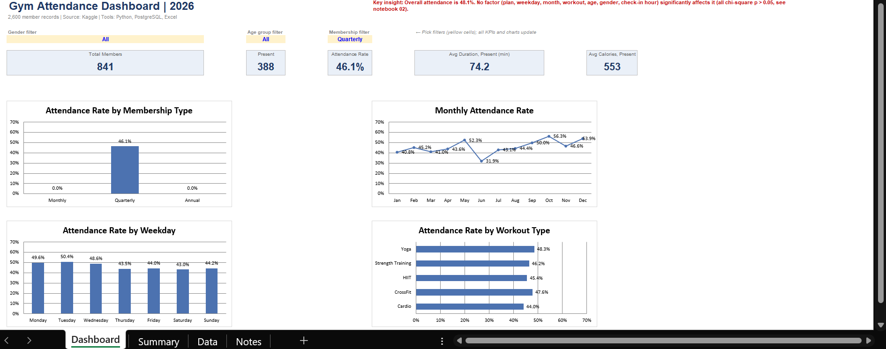
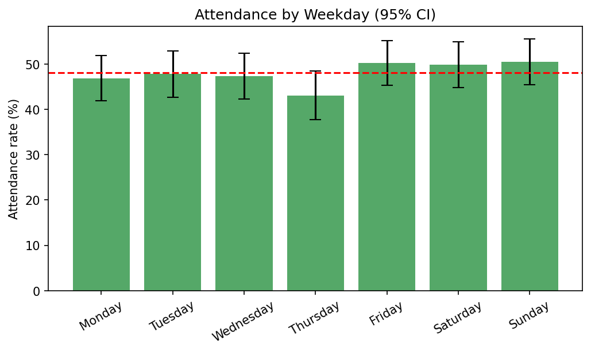
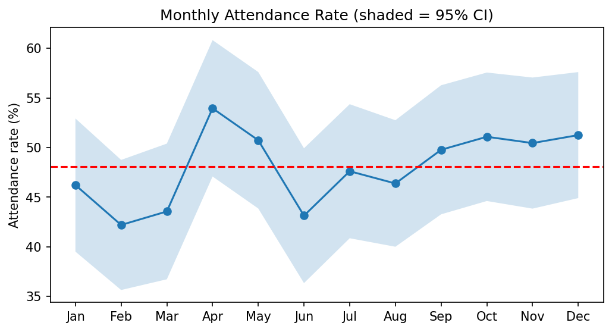
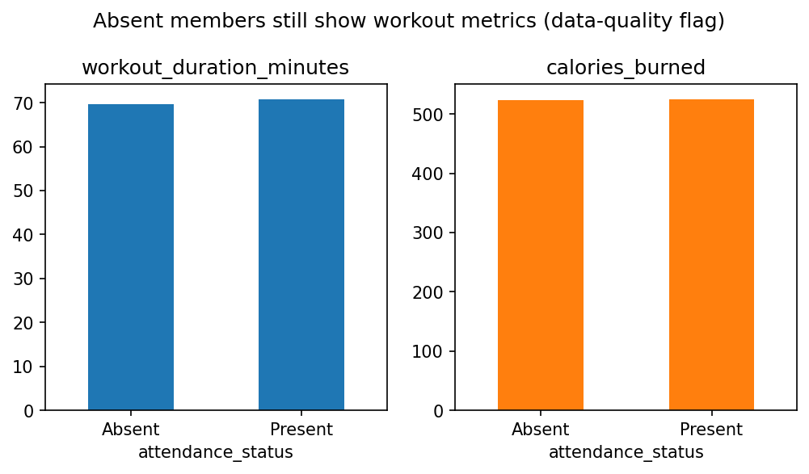

# Gym Attendance Analysis: What Actually Drives Member Attendance?

> **Headline finding:** Only **48.1%** of members attended, and no factor tested (plan, weekday, month, workout, age, gender, check-in hour) had a statistically significant effect. All chi-square p-values are above 0.05.



## Problem Statement
Fitness platforms and gyms lose money when members pay but don't show up, and they struggle to plan staffing and offers without knowing who attends and when. This project analyzes a year of gym attendance records to find out **what, if anything, predicts attendance**, and what data is needed to go further.

## Dataset
- **Source:** [Daily Gym Attendance and Workout Activity Data (Kaggle)](https://www.kaggle.com/datasets/jayjoshi37/daily-gym-attendance-and-workout-activity-data)
- **Size:** 2,600 rows, 10 original columns, dated 1 Jan to 31 Dec 2024
- **Columns:** member_id, visit_date, age, gender, membership_type, workout_type, workout_duration_minutes, calories_burned, check_in_time, attendance_status
- **Limitation:** each member appears **once** (2,600 unique members in 2,600 rows), so retention, churn, and cohort analysis aren't possible with this data.

## Tools
| Tool | Used for |
|---|---|
| Python (pandas, SciPy, matplotlib) | Cleaning, feature engineering, chi-square tests, charts |
| PostgreSQL | Schema design and 10 analytical queries (window functions, CTEs, `FILTER`) |
| Excel | Interactive dashboard with KPIs, charts, and dropdown filters |
| Git / GitHub, Google Colab | Version control and notebooks |

## Business Questions
1. What is the overall attendance rate, and does it differ by membership type?
2. How does attendance vary by month and weekday?
3. Which workout types, age groups, and genders attend most?
4. Is there a peak time of day for check-ins?
5. How reliable is the data?

## Approach
1. **Cleaning (Python):** parsed `visit_date` and text `check_in_time` (HH:MM), checked nulls and duplicates (none found), and engineered `month`, `weekday`, `is_weekend`, `check_in_hour`, `age_group`, and `is_present`.
2. **SQL (PostgreSQL):** loaded the cleaned CSV and wrote 10 queries covering attendance rates, month-over-month change (`LAG`), rankings (`RANK`), top workout per plan (CTE + window), and data-quality checks.
3. **Statistics (Python):** ran chi-square tests of independence between each factor and attendance. Charts include 95% confidence intervals so noise isn't mistaken for patterns.
4. **Dashboard (Excel):** KPI cards, 4 charts, and dropdown filters (gender, age group, membership).

## Key Findings

**1. Overall attendance is 48.1%** (1,250 of 2,600; 95% CI 46.2% to 50.0%). About half of members did not show up.

**2. No factor significantly drives attendance.**

| Factor | p-value |
|---|---|
| Membership type | 0.380 |
| Weekday | 0.456 |
| Month | 0.282 |
| Workout type | 0.705 |
| Age group | 0.448 |
| Gender | 0.603 |
| Weekend vs weekday | 0.179 |
| Check-in hour | 0.789 |

Some gaps look large in raw numbers (April 54.0% vs February 42.2%; Thursday 43.1% vs Sunday 50.5%), but each group has only about 200 to 400 records, so the differences fall within sampling noise.




**3. Check-in volume is spread evenly through the day** (5 AM to 11 PM). A chi-square test found no significant peak (p = 0.057), so this data doesn't support hour-based staffing changes.

**4. Data-quality issue:** all 1,350 *Absent* records still contain workout duration and calories, with averages almost identical to *Present* records (about 70 min and 525 kcal). Workout metrics should be computed on **present records only**, and the data pipeline should be checked.



## Recommendations
- **Don't target by plan, weekday, or workout type** based on this data. No segment is significantly better or worse.
- **Fix the data capture:** absent members should have null or zero workout metrics.
- **Collect member-level history** (multiple visits per member, plan start and end dates). That enables retention, churn, and early-disengagement analysis, which are the analyses that would move attendance.
- **Re-test with a larger sample.** Small differences (e.g. weekends at 50.2% vs weekdays at 47.2%) could become significant with more data.

## Dashboard
`dashboard/gym_dashboard.xlsx` contains KPI cards, 4 charts, and dropdown filters that update every number and chart. Summary tables are formula-driven (`COUNTIFS`, `AVERAGEIFS`) and match the SQL results exactly.

## Repository Structure
```
gym-attendance-analysis/
├── data/
│   ├── raw/        original Kaggle CSV (untouched)
│   └── clean/      gym_clean.csv
├── notebooks/
│   ├── 01_data_cleaning.ipynb
│   ├── 02_eda_visuals.ipynb
│   └── 03_sql_analysis.ipynb
├── sql/
│   ├── 01_schema.sql
│   ├── 02_load_data.sql
│   └── 03_analysis_queries.sql
├── dashboard/
│   ├── gym_dashboard.xlsx
│   └── dashboard_preview.png
├── images/         chart PNGs
├── requirements.txt
└── README.md
```

## How to Run
1. Clone the repo and install dependencies: `pip install -r requirements.txt`
2. Run `notebooks/01_data_cleaning.ipynb` to reproduce `gym_clean.csv`.
3. Create a PostgreSQL database, then run `sql/01_schema.sql` followed by `sql/02_load_data.sql`. Run it from the repo root, since the load script uses a relative path.
4. Run `sql/03_analysis_queries.sql`, or `notebooks/03_sql_analysis.ipynb` in Google Colab, which installs Postgres automatically.
5. Open `dashboard/gym_dashboard.xlsx` to explore the dashboard.

## Author
**Raghav Siddharth**: Data Analyst
[LinkedIn](YOUR_LINKEDIN_URL) | [GitHub](https://github.com/raghavxi1) | raghavsid2005@gmail.com
